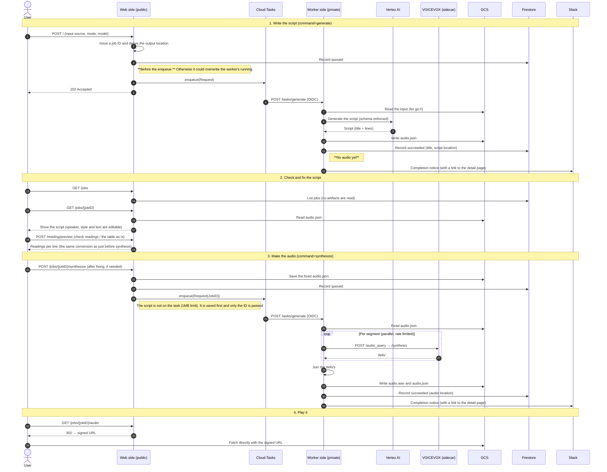

# ✍️ AP Voice

[](https://github.com/shouni/ap-voice/actions/workflows/ci.yml)
[](#)
[](https://go.dev/)
[](https://cloud.google.com/run)
[](https://opensource.org/licenses/MIT)

English | [日本語](README.ja.md)

## 🚀 About

**Write the script first, check it, then give it a voice.**

**AP Voice** is a service on Cloud Run + Cloud Tasks that turns documents into narration audio.

It reads a web article or a document on GCS and has Gemini generate a **script that names the speaker and style** for every line (JSON).
**The script and the audio are separate steps.** Once the script is ready it appears in the history, so you check its content and then
**synthesise it in parallel with the VOICEVOX engine**. To fix a reading or a speaker, you rerun only the
synthesis, as many times as you like, without regenerating.

One image is deployed with `SERVER_ROLE` as **two services: the web side (public) and the worker side (private)**.
Both input and output handle web URLs / GCS (`gs://`) / local paths transparently.

---

## 📦 Usage

### 1. Configuration

`ValidateEssentialConfig` validates only what each role needs. Requiring settings for a side the
process does not serve would hand out access to credentials it never uses.

**Required for every role**

| Variable | Description |
| --- | --- |
| `SERVER_ROLE` | `web` / `worker` / `both` (`both` is for local development). **Unset or unknown values are a startup error.** Only the sides it serves are assembled, and only their routes are registered. |
| `GEMINI_MODELS` | Gemini model names. **Several can be given, comma-separated; the first is the default model.** Used when a task's `ai_model` is empty. **There is no default; unset is a startup error.** |
| `GCP_PROJECT_ID` | GCP Project ID. **Gemini is called only through Vertex AI** (there is no API key path). Local runs need ADC. |
| `GCS_VOICE_BUCKET` | Where scripts and audio go. Users do not enter the output location; `gs://<bucket>/voice/<jobID>/audio.wav` is derived from the job ID. web uses it to show the history and the worker to read stored scripts, so it is **required for both roles**. |

**Required on the web side (`web` / `both`)**

| Variable | Description |
| --- | --- |
| `CLOUD_TASKS_QUEUE_ID` | The queue to enqueue to. |
| `WORKER_URL` | The URL of the worker **service**. No path. |
| `TASK_CALLER_SERVICE_ACCOUNT_EMAIL` | The caller SA stamped on tasks. **Cloud Tasks issues the token**; this process signs nothing. |
| `GOOGLE_CLIENT_ID` / `GOOGLE_CLIENT_SECRET` | The Google OAuth client. |
| `SESSION_FIRESTORE_DATABASE` / `SESSION_FIRESTORE_COLLECTION` | The Firestore that holds sessions (both default to `sessions`). **It names a different database from the one for job states.** |
| `ALLOWED_EMAILS` / `ALLOWED_DOMAINS` | Who may log in (comma-separated). **If both are empty, it does not start.** |
| `ALLOWED_M2M_SERVICE_ACCOUNTS` | SAs allowed when a machine (the MCP server and so on) calls with an OIDC Bearer token (comma-separated). **Optional** — when empty, M2M verification always fails and everything falls through to session authentication. |

**Required on the worker side (`worker` / `both`)**

| Variable | Description |
| --- | --- |
| `TASK_AUDIENCE_URL` | The audience for OIDC verification (the worker's own URL). Falls back to `SERVICE_URL` when unset. |
| `ALLOWED_TASK_SERVICE_ACCOUNTS` | The caller SAs accepted (comma-separated). Give the **enqueuing side's** SA. web and worker run as different SAs, so the worker's list holds "someone else's SA". |

**Optional**

| Variable | Description |
| --- | --- |
| `SERVICE_URL` / `PORT` | The public URL and the listening port (Default: `http://localhost:8080` / `8080`). |
| `VOICEVOX_API_URL` | The engine's URL. Falls back to `http://localhost:50021` when unset (that value suits both local runs and the Cloud Run sidecar setup). |
| `VOICEVOX_MAX_PARALLEL_SEGMENTS` | Segments sent concurrently within one job (Default: `4` = the engine's vCPU count). **This is what bounds throughput.** Synthesis is CPU-bound, so 4 vCPUs saturate at 4 concurrent requests; measured at 8, throughput stayed flat while the time per segment doubled. The override is there for reverting. |
| `VOICEVOX_SEGMENT_RATE_LIMIT` | The interval between segment submissions (Default: `100ms`). **Not the throughput knob** (against a measured effective 0.24 segments/s, 100ms allows 10/s). It is insurance against hitting the engine all at once at startup; concurrency is bounded by `VOICEVOX_MAX_PARALLEL_SEGMENTS`. |
| `VOICEVOX_SEGMENT_TIMEOUT` | The limit per segment (Default: `120s`). **"One segment" is two round trips, query and synthesis**, and each round trip is retried at most once. The limit per round trip is `HTTP_TIMEOUT`. |
| `GCP_LOCATION_ID` | **The Cloud Tasks queue's region** (Default: `asia-northeast1`). Separate from the Vertex AI endpoint, which is pinned to `global`. |
| `FIRESTORE_DATABASE` | The Firestore database name that holds job states (Default: `job-status`). A named database is used so as not to occupy the `(default)` slot. The collection name is not a setting (it is the service's identity and does not change per deployment). |
| `HTTP_TIMEOUT` | The timeout for outgoing HTTP calls (**one HTTP round trip**) (Default: `60s`). It is half the per-segment limit (`VOICEVOX_SEGMENT_TIMEOUT`) — raised to the same value, the first round trip could use up the segment's budget and leave no room for a retry. Raising the segment limit does not lengthen a round trip (the smaller one takes effect first). Slack notifications use the same client, so this is also how long they wait when there is no response. |
| `PIPELINE_TIMEOUT` | The cap on one job's run (Default: `25m`). It exists so that **the app gives up before Cloud Tasks does**; past it, the failure is notified and the run ends. |
| `TASK_DISPATCH_DEADLINE` | How long Cloud Tasks waits for the worker's response (Default: `30m`, Cloud Tasks' maximum). Keep it longer than `PIPELINE_TIMEOUT`. |
| `AP_MUSIC_BUCKET` | Where music recipes (`recipe.json` in `music.Recipe` form) live (no default; when unset, only this tab stops accepting job IDs). The create page's 「楽曲レシピ」 (music recipe) tab uses it to build `gs://<bucket>/music/<jobID>/recipe.json` from a music generation service job ID. **Same variable name and rule as the video generation service.** |
| `SLACK_WEBHOOK_URL` | Where completion and failure are notified. Notifications are disabled when unset. |
| `GOOGLE_APPLICATION_CREDENTIALS` | Only when reading or writing `gs://` (when using ADC). |

> Environment variables hold only **settings the deployment target decides**. Values that change per
> run, such as the input, the output location and the generation mode, are passed in the task payload (JSON).

### 2. Running

```bash
go run .        # SERVER_ROLE is required
```

Only the sides `SERVER_ROLE` serves are assembled.

| Role | What it assembles | Routes exposed |
| --- | --- | --- |
| `web` | Submission form, mode listing, history pages, enqueueing to Cloud Tasks | `/`, `/modes/*`, `/speakers`, `/reading/preview`, `/jobs/*`, `/auth/*` |
| `worker` | The pipeline (Gemini + VOICEVOX + GCS + notifications) | `POST /tasks/generate` |
| `both` | Both (for local development) | All of the above |

### 3. HTTP endpoints

**There is one authentication.** `auth.Protected` accepts both an OIDC Bearer token and a session,
so people and machines call the same URLs (the same shape as the sibling services). Only `GET /health` and `/static/*`
sit outside authentication, and they are registered regardless of role.

| Method | Path | Purpose |
| --- | --- | --- |
| `GET` | `/health` | Health check (`/healthz` is not used because it is treated as a reserved path on Cloud Run's default domain and never reaches the container). No authentication |
| `GET` | `/static/*` | The embedded CSS / JS and Bootstrap under `vendor/`. No authentication. `vendor/`, whose path carries the version, is `public, max-age=31536000, immutable`; our own assets, whose URLs do not change, are `public, max-age=300, must-revalidate` |
| `GET` | `/auth/login` `/auth/callback` `/auth/logout` | Google OAuth login, callback and logout |
| `GET` | `/` | The submission form (three tabs: input source / music recipe / script JSON) |
| `GET` | `/modes` | The modes that can be chosen (key, display name, description). The front matter is the only source |
| `GET` | `/modes/{mode}` | One mode's detail. It shows **the prompt text that actually reaches Gemini** (partials expanded). A key not in the listing is a 404 |
| `GET` | `/speakers` | The styles each speaker can use. **A non-existent pair is rejected on save**, so check here before choosing |
| `POST` | `/reading/preview` | Returns, per line, **how it would be read if synthesised** (no synthesis). 「水面」 reads スイメン, not ミナモ. Used by the editor's 「読みを確認」 (check readings) button and by machines |
| `POST` | `/jobs` | Enqueue a job. A form body is the page's three tabs; a JSON body is a machine. JSON's `command` is `generate` / `generate_and_synthesize` (have the AI write from an input source) / `synthesize` (pass a `script` to have your own script spoken; Gemini is not called). Accepted with `202` and `Location: /jobs/{jobID}` |
| `GET` | `/jobs` | Jobs, newest first. `?page=` / `?per_page=` (default and cap both 100) / `?state=` (`queued` / `running` / `succeeded` / `failed`). Each entry carries `state`, so running and failed jobs can be told apart without fetching each one. **`?state=` needs a Firestore composite index (`state` ascending + `queued_at` descending)** — without the index, only filtered requests fail |
| `GET` | `/jobs/{jobID}` | One job. The same URL from enqueue to delete. Browsers get the detail page (**the script is fixed here** — adding, reordering and deleting lines, checking readings. It opens even for a job with no script yet and shows the recorded state and failure reason). `Accept: application/json` gets the progress (`queued` / `running` / `succeeded` / `failed`), the artifact locations (`audio_uri` / `script_uri`), and the `mode` / `input_uri` / `ai_model` the script was made with (used to regenerate). **With no record it is a 404**, which callers treat as `unknown`. The detail page's auto-refresh and machine polling read the same thing |
| `DELETE` | `/jobs/{jobID}` | Delete the artifacts together. The page's delete button also sends DELETE through fetch. For a job without any artifacts (one that failed before writing a script), only the record is deleted. With no record either, a 404 |
| `GET` | `/jobs/{jobID}/audio` | A **playable link** to the audio (a signed URL, 1 hour). Browsers get a 302, `Accept: application/json` gets the URL itself. It is not put on the state or the listing — it expires, and issuing one on every poll is wasteful. A 404 when there is no audio |
| `GET` | `/jobs/{jobID}/script` | The **stored** script. Opened from a browser it downloads as `<jobID>.json`. It is a small JSON, so unlike the audio it is returned directly without a signed URL |
| `PUT` | `/jobs/{jobID}/script` | Replace the script. **No synthesis** (fix it a few times, then synthesise once) |
| `POST` | `/jobs/{jobID}/synthesize` | Make the audio. JSON (no body) uses the stored script. A form (the editor's button) saves the script being edited first. **The script does not ride on the task** (it is saved first and only the job ID is passed). `202` and `Location` |
| `POST` | `/jobs/{jobID}/regenerate` | **Rewrite the script from the same input source.** The input source is restored from the record, so nothing needs pasting again. The job ID does not change |
| `POST` | `/tasks/generate` | The worker, for Cloud Tasks only. A request that fails OIDC verification gets 401; with `SERVER_ROLE=web` **the route is not registered at all**, so 404 |

**One resource, one route.** `Accept` decides the representation: send `application/json` and you get
JSON, a browser's `Accept` gets the page. Error bodies follow the same decision and become `{"error": "..."}`.
Paths follow the public-docs URL naming conventions.

**Methods with side effects need a CSRF token.** Forms send it as a `csrf_token` hidden field, and
the page's JS as an `X-CSRF-Token` header. Machines authenticated with an OIDC Bearer token skip this check
(CSRF defends against attacks that abuse cookies being sent automatically, which does not apply to calls that
attach a Bearer token explicitly. Callers are narrowed with `ALLOWED_M2M_SERVICE_ACCOUNTS` instead).

Script validation (whether speakers and styles exist, the line cap) goes through **the same function** for the page and the API.

### 4. Task payload

Script generation and speech synthesis are separate entry points (for the reason, see [About](#-about)).

| `command` | What it does | Required fields |
| --- | --- | --- |
| `generate` | Writes a script from an input source. **Makes no audio** | `input_uri`, `output_uri` |
| `synthesize` | Makes audio from a stored script (does not call Gemini) | `output_uri`, `job_id` |
| `generate_and_synthesize` | Writes the script and goes straight on to the audio. **No check in between** | `input_uri`, `output_uri` |

| Field | Description |
| --- | --- |
| `command` | `generate` / `synthesize` / `generate_and_synthesize`. **Cannot be omitted** (if a caller supplied a script and forgot it, the script would be silently discarded and a generation would run). |
| `input_uri` | **Input source URI**. A web URL or GCS (`gs://`). Required for `generate`. |
| `job_id` | The job's identifier. The artifacts' location is derived from it too. For `synthesize` it is also where the stored script is, and it is **required**. |
| `output_uri` | **The WAV's output URI**. The script is placed next to it with the extension changed to `.json`. Not entered when enqueueing from the web side (`gs://<bucket>/voice/<jobID>/audio.wav` is derived from the job ID). |
| `mode` | The script's format. `generate` only. **Placing `assets/prompts/<genre>_<format>.md` adds a mode.** The display name and description come from the file's front matter (`label` / `direction` / `use_when`). The order of the options is decided by `order` in the same front matter (steps of 10, smaller first).<br>The list is at `GET /modes`. |
| `ai_model` | The Gemini model name to use. Empty means the head of `GEMINI_MODELS`. `generate` only. |

```json
{
  "command": "generate",
  "input_uri": "https://example.com/tech-news",
  "output_uri": "gs://my-bucket/audio/tech-news.wav",
  "mode": "tech_dialogue"
}
```

```json
{
  "command": "synthesize",
  "job_id": "voice-20260814-020913-b1b8b2f9e8d7",
  "output_uri": "gs://my-bucket/voice/voice-20260814-020913-b1b8b2f9e8d7/audio.wav"
}
```

**The script does not ride in the payload.** A long script could hit Cloud Tasks' 1MB limit, so
the enqueuing side saves it first and passes only the `job_id`. The same goes for having your own script spoken:
pass it to `POST /jobs` (JSON with `command: "synthesize"` and `script`) or the page's 「台本 JSON」 (script JSON) tab,
where it is saved and then becomes a task of this shape.

---

## 🔄 Sequence diagram



## 🌳 Project structure

```text
ap-voice/
├── main.go                  # Entry point (starts the server)
├── Dockerfile               # scratch image (static binary only)
├── cloudbuild.yaml          # Build and deploy to the two services
├── assets/                  # Embedded (prompts/*.md, speakers.json, templates/*.html, static/)
│                            #   static/js is app.js (every page) + per page (pageScripts in handlers)
└── internal/
    ├── config/              # Loading environment variables and per-role validation
    ├── server/              # chi router, graceful shutdown
    │   └── handlers/        #   The web side (submission form, history, detail, playback)
    ├── domain/              # Domain models, port definitions, artifact path conventions
    ├── app/                 # DI container and resource management
    ├── builder/             # Assembling external dependencies and handlers
    ├── repository/          # Reading artifacts (scripts) and reading/writing job state (history)
    ├── pipeline/            # The worker. planner.go maps a command to steps; each step is step_*.go
    └── adapters/            # Gemini / VOICEVOX / Cloud Tasks / Slack / prompts
```

---

## 📜 License

* Characters used: VOICEVOX:ずんだもん, VOICEVOX:四国めたん, VOICEVOX:春日部つむぎ and others
  (**the usable speakers are decided by `assets/speakers.json`** = the engine's `/speakers` response.
  The library ships no roster)
* This project is released under the [MIT License](https://opensource.org/licenses/MIT).
